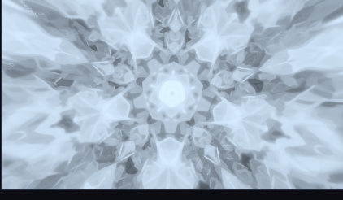
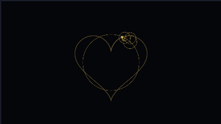
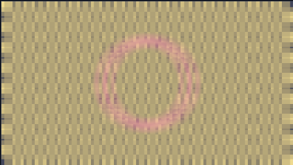
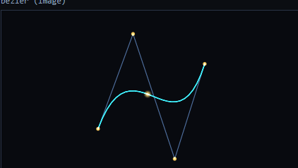

# dsh-shader-workbench

[](LICENSE)
[](docs/开发与验证.md)
[](docs/开发与验证.md)

[简体中文](README.md) · **English**

A **node-based GLSL workbench** for [DSH (DeepSeek Harness)](https://github.com/deepseek-ai/deepseek-harness):
wire up a graph, watch it render live with Shadertoy-compatible output, hot-reload as you edit,
and keep your projects and materials in a local workspace.

Installed into DSH it gives you a sidebar entry plus one full workbench panel, and it exposes
11 tools so an agent can create projects, build graphs, compile, export and snapshot the same data
you see in the panel.

- **Zero runtime dependencies.** No build chain — plain hand-written ESM JavaScript. Installing it
  means dropping a directory somewhere.
- **The graph *is* the program.** The built-in library holds **57 generic nodes** only. Anything
  effect-specific gets broken down into ordinary nodes you can open and edit on the canvas — no
  black boxes.
- **Repetition is a language feature.** A group with "repeat" > 1 compiles to a real loop; the body
  is written once (the 99-step IFS tunnel and the 24-segment Bézier both rely on it, keeping the
  graph and the generated shader two orders of magnitude smaller).
- **Extensible without restarting.** Drop a JSON file into `<workspace>/library/nodes/` to add a
  node; node categories and project names are both hierarchical.
- **Undo/redo, grouping and canvas notes.** A snapshot-based undo stack (dual count + byte budget,
  same-kind operations coalesced), plus group frames and notes you can drag around the canvas.
- **One graph, five platforms.** GLSL / HLSL / MSL / SPIR-V (a real `.spv` binary plus a readable
  `.spvasm`) / JSON bundle. Both the cross-compiler and the SPIR-V binary encoder are written
  from scratch — no external shader toolchain is required.
- **Bring Shadertoy shaders straight in.** Paste a `mainImage()` source and it becomes a reusable
  user node; a material can be packed into a ZIP and carried away.
- **Resources travel with the material.** Images, audio and lyrics all live in one manifest list
  (`resources[]`, backed by an extensible type registry). Lyrics render as an HTML layer over the
  canvas — LRC timeline highlighting, no shader cost.
- **Panel and agent share one toolset and one workspace.** The storage root is editable in the panel;
  both sides always look at the same data.
- **169 test cases**, including real WebGL2 compile checks, GPU pixel readback, real mouse-drag
  interaction, 1080p performance measurement, and point-by-point numerical equivalence of the
  cross-platform translations.

## Install

```bash
cd ~/.dsh/profiles/desktop
# package.json: add "dsh-shader-workbench": "file:<path to this repo>" to dependencies,
#               and "dsh-shader-workbench" to dsh.profile.bundles
node <path to pnpm.cjs> install
```

Restart DSH and a "Shader 工作台" entry shows up in the sidebar.
Storage location, configuration and load troubleshooting: [docs/安装与配置.md](docs/安装与配置.md).

## Eight bundled examples

Click **载入示例** (Load example) in the panel's resource tree. Not a single new node type was added
for them — they are built entirely from the existing library.

<table>
<tr>
<td align="center"><br><sub><b>IFS tunnel</b> (Phantom Star port)<br>99 accumulation steps = one repeat group, pixel-identical to the original</sub></td>
<td align="center"><br><sub><b>DFT epicycles</b> drawing a heart<br>one node per rotating vector, trail accumulated in BufferA</sub></td>
</tr>
<tr>
<td align="center"><br><sub><b>9-tap Gaussian blur</b><br>two passes, adjustable radius</sub></td>
<td align="center"><br><sub><b>Cubic Bézier</b><br>24 sampled segments as one repeat group, draggable control points</sub></td>
</tr>
</table>

The other four (Fourier series, harmonic spectrum, depth of field, FFT music visualisation) and how
each one is built: [examples/README.md](examples/README.md).

## Documentation

> The detailed docs are Chinese-first for now; English issues and pull requests are very welcome.

| Document | Contents |
|---|---|
| [安装与配置.md](docs/安装与配置.md) — Install & config | Installing, storage location and precedence, security boundaries, load troubleshooting |
| [使用手册.md](docs/使用手册.md) — User manual | UI, canvas operations and shortcuts, the 57-node library, resources (images / audio / lyrics), the 11 tools, workspace layout |
| [扩展指南.md](docs/扩展指南.md) — Extending | Three ways to add nodes: user nodes / groups and repeat groups / built-in nodes |
| [开发与验证.md](docs/开发与验证.md) — Dev & verification | Dev commands, real-machine verification and measured performance, size, what's not done yet |
| [接口契约.md](docs/接口契约.md) — Interface contract | HTTP actions, node definition and codegen contracts (**read this before changing code**) |
| [架构说明.md](docs/架构说明.md) — Architecture | Layers, data flow, key design tradeoffs and the pits we fell into |
| [验收报告.md](docs/验收报告.md) — Acceptance report | Per-milestone acceptance records from real runs |
| [examples/README.md](examples/README.md) | What each of the 8 examples demonstrates and how it is wired |

## Repository

- Repository: <https://github.com/Moolight/dsh-shader-workbench>
- Issues: <https://github.com/Moolight/dsh-shader-workbench/issues>
- License: [MIT](LICENSE)

---

"Workbench" is meant literally: this is a workbench, not a render engine — the engine is just WebGL2,
and everything else exists so you can wire nodes and watch the picture at the same time.
