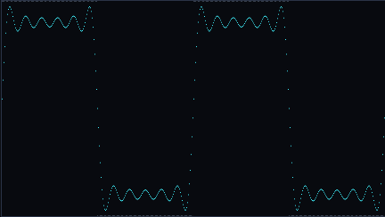
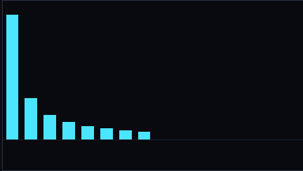
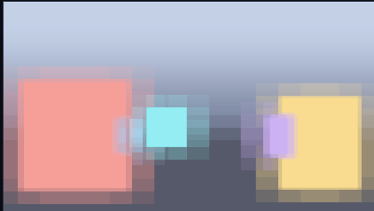

# 自带示例

这个目录里的东西**随插件分发**，不依赖运行期工作区 —— 换机器、重装 profile、
或者把「存储位置」改到别处，示例都还在。

## 怎么载入

面板 → 资源树 → **载入示例**（工作区还空着时，空状态里也有一个入口）。
已经存在同名项目时会问一句要不要覆盖；接口是
`{"action":"example.load","name":"demo"}`（`overwrite: true` 才覆盖）。

载入就是把这里的整个目录**拷进** `<工作区>/projects/<名字>/`，
形状与工作区完全一致，所以不会把示例里调好的参数、清单和预览图弄丢。

## 示例里没有"黑盒节点"

这几个效果（傅里叶级数 / 频谱 / 本轮 / IFS 隧道）走过一段弯路，值得记下来：

1. 最早它们是**内置专用节点**（`ifsTunnel` / `fourierSeries` / `epicycles`）——
   循环写在节点的 `glslPrelude` 里。问题是：用不上的人也得背着这段源码，
   而且在画布上**展不开、改不了**，就是一颗黑盒。
2. 后来改成**示例自带的用户节点**（`examples/<名>/library/nodes/*.json`）——
   不用改插件源码了，但**还是黑盒**，还是展不开。
3. 现在的做法：**把循环展开成节点链**，效果就是一张普通的图。

| 示例 | 画布节点 | 原来那个黑盒现在长什么样 |
|---|---|---|
| `fourier-series` | 10 | 每个奇次谐波一个 `custom` 节点，链式累加 —— **想加项就再加一个节点** |
| `fourier-spectrum` | 12 | 每根柱一个节点（`max(累加, 本柱)`） |
| `fourier-epicycles` | 32 + BufferA 17 | 每个旋转向量一个节点；**轨迹靠 BufferA 反馈**（笔尖走过的印子逐帧衰减） |
| `demo` | 10 | 原版照搬：99 步累积封成一个**重复组**（循环体只写一遍），逐像素一致 |

两个代价说清楚：

- **`terms` 滑块没了**：项数现在是图上节点的个数。想 20 项就复制节点 ——
  比改一个数字麻烦，但它是看得见、改得动的，这正是换来的东西。
- **循环用「重复次数」，别复制节点**。IFS 隧道一度是 99 份循环体复制：
  801 个节点 / 676 KB 着色器 / 2 MB 图 / codegen 352 ms，面板一打开就卡；
  贝塞尔的 24 段复制也要 51 KB 着色器。现在两者都是**重复组**（组的「重复次数」> 1，
  循环体只写一遍）：10 个节点 / 9 KB / 34 KB 图。
  这是"和原版逐像素一致"和"打开不卡"之间唯一能同时成立的做法 ——
  中途试过"少几步 + 放大步长"省节点，采样噪声和亮度都对不上，一比就露馅。

> 一致性是**量出来的**而不是"看着像"：探针把原版 `.frag` 和展开版并排渲，
> 六个采样点在两个时间点上**逐像素相同**（`center=110,121,132` / `206,227,247` …）。
> 素材在 `scripts/.ifs-compare/`。

> 生成脚本：[`scripts/rebuild-primitive-demos.mjs`](../scripts/rebuild-primitive-demos.mjs)。
> 它只允许用 `uv` / `time` / `custom` / `output` / `bufferSample` 这几种基础件，
> 测试里也有对应的护栏（`examples.test.js`：不许带用户节点、不许出现非内置类型、
> 不许有 `glslPrelude`）。
>
> 顺带一提，**「组（Group）」是可以展开的**：右键那颗组节点 →「拆开组」，
> 子图会还原成普通节点。`gaussian-blur` / `depth-of-field` / `bezier` 这三个示例
> 就是用组把几十个节点包成一颗的，展开就能改。

## demo — Phantom Star（IFS 隧道）

[Shadertoy ttKGDt](https://www.shadertoy.com/view/ttKGDt) 的节点图移植
（原作者 kasari39，2020；累积辉光思路来自 aiekick 的 Phantom Mode）。

```
demo/
├── project.json
└── materials/phantom-star/
    ├── graph.json                     节点图（uv + time → group(重复组, repeat=99) → output，10 个节点）
    ├── material.json                  材质清单
    ├── phantom-star.frag              这个图生成的 GLSL（对照用）
    └── preview.png                    真机跑出来的样子
```

图里 10 个节点（`uv` / `time` / `custom` / `group` / `output`），重活封在一个**重复组**里：
`repeat = 99`，循环体用 `custom` 节点写 IFS 折叠与累积辉光，99 步只写一遍（和原版逐像素一致）。
下面这些量仍可调：

| 参数 | 默认 | 说明 |
|---|---|---|
| 累积步数 | 99 | 沿光线累积多少次（原作就是 99） |
| 辉光衰减 | 3 | `exp(-距离 × 这个值)`，越大越"薄" |
| IFS 折叠次数 | 5 | `p = abs(p) - 1` 重复几次 |
| 前进速度 | 3 | 相机每秒往前多少 |
| 脉冲强度 | 1 | 那条沿路程脉动的亮带 |
| 曝光 | 0.01 | 整体亮度 |
| 色调 | 白 | 色调乘数 |

改这几个参数就能得到同族但不同的画面（折叠次数调到 2~3 会变成另一种分形结构）。

---

## 傅里叶变换三件套

三个各自独立的示例，从三个角度看同一件事：**任何信号都能拆成一堆正弦 / 旋转向量。**

### fourier-series — 方波 = 正弦叠加



理想方波（灰色虚线）vs 前 N 项正弦之和（青色）。调「项数」能直接看到两件事：

- 项数越多越贴近方波；
- **吉布斯振铃**：跳变处永远会过冲，加多少项都消不掉（只是过冲越来越窄）。

参数面板里把「显示」切到 `FS_SHOW_STACK`，会变成每行一个谐波、最上面是它们的和 ——
能看清"每一项长什么样、它们是怎么凑出方波的"。

### fourier-spectrum — 每根柱是一次谐波



上面是这些分量重建出来的波形，下面是频谱：柱高 = 该次谐波的幅度。
方波只有奇次谐波，幅度按 `1/n` 衰减（1、1/3、1/5、1/7…），
所以"越来越矮"——这就是为什么方波在频域里是无穷多项。

参数面板里换「波形」：`FS_WAVE_SAW`（锯齿，全次 `1/n`）、
`FS_WAVE_TRI`（三角，`1/n²` 掉得快 → 几项就很像）。

### fourier-epicycles — DFT 逆变换画出一条曲线

一串长度、转速、初相各不相同的旋转向量首尾相接，笔尖就画出目标曲线 ——
这就是离散傅里叶变换的逆变换（IDFT）在画面上的样子。

- 选**心形**：只要 **8 个**旋转向量就能精确画出它 ——
  因为心形的参数方程本身就是 8 个旋转向量之和。
- 换成**五角星**：尖角让谐波衰减很慢，要 **57 个**才收敛。
  把「本轮个数」从 1 往上拖，能看着它从一团乱线慢慢变成星形。

系数是对参数曲线做 DFT 烘焙进 `shared/fourier-data.js` 的
（DFT 是 O(N²)，每个像素现算不可能）；重烤走
`node scripts/bake-fourier-epicycles.mjs`。

> 三个傅里叶示例都是**纯节点链**，不再是黑盒：
> `fourier-series` 10 个节点（每个奇次谐波一个 `custom`）、
> `fourier-spectrum` 12 个节点（每根柱一个）、
> `fourier-epicycles` 49 个节点（每个旋转向量一个 `custom` + BufferA 反馈）。
> 系数来自 `shared/fourier-data.js`（对参数曲线做 DFT 烘焙进来，DFT 是 O(N²)，
> 每个像素现算不可能；重烤走 `node scripts/bake-fourier-epicycles.mjs`）。
> 这正是「效果应该是图、不是代码」的示范——想加一项谐波就再加一个 `custom` 节点。

---

## 用现有组件搭的三个效果

这三个跟上面不一样：**一个新节点都没加**，全部用现有组件搭出来，重活打进
`group` 元节点。它们也是「想加效果别改插件源码」的示范 —— 效果应该是**图**，不是代码。

| 示例 | 画布上的节点 | 组里藏了多少 |
|---|---|---|
| `gaussian-blur` | 8 | 30（9 抽样高斯核） |
| `depth-of-field` | 11 | 30（同一个核，半径按深度算） |
| `bezier` | 9 | 30（24 段采样求最小距离） |

### gaussian-blur — 9 抽样可分离核

**BufferA** 画一张硬边棋盘（带个圈），**image** 用组做 9 抽样高斯模糊。
组里每个抽样 3 个节点：`custom` 算偏移 → `bufferSample` 采源 → `custom` 加权累加。
权重是 3×3 高斯核（和为 1），半径接的是 `uRadius` 滑块 —— 拖一下就能看到
"糊"是怎么发生的。

### depth-of-field — 半径由深度决定



同一个模糊组，只是半径不接滑块，接一个算**弥散圆**的 `custom`：
`|深度 − 对焦距离| × 光圈`。

关键一步：**深度写进 BufferA 的 alpha**。没有深度缓冲的话，image Pass 只知道
屏幕坐标、不知道这个像素有多远，弥散圆根本算不出来 —— 颜色进 RGB、深度进 A、
下一 Pass 读回来，是这类效果的标准做法。

场景是平地上几块不同距离的方块（不是透视棋盘：透视花纹在掠射角必然摩尔纹，
糊出来一片竖条）。拖「对焦距离」能看着焦点前后移动。

### bezier — 24 段采样求到曲线的最小距离

三次贝塞尔的点 = 四个控制点的加权和，所以曲线上的点可以**烤成常量系数**。
每段一个 `custom`：`min(目前最小距离, 到这一段的距离)`。

两个坑写在这儿免得重踩：

1. **要量线段，不能只量端点**。只量端点到曲线的距离，画出来是一串**虚点**
   （端与端之间的空隙被高估了）。线段距离的两个端点都是烤进来的常量，
   所以不需要多一个节点、也不用多接一根线。
2. 像素坐标不用接线 —— `gl_FragCoord` 在 `custom` 里可以直接用，
   三个输入端口（`a`=P0P1、`b`=P2P3、`c`=累加器）刚好够。

四个控制点是 `uniform`（`uP0`~`uP3`），在面板「自定义参数」里直接拖，曲线实时变；
沿曲线跑的小球用的是 `iTime`，同样不用接线。

> 生成脚本是 [`scripts/build-effect-demos.mjs`](../scripts/build-effect-demos.mjs)，
> 改完重跑一遍会重新生成示例 + 校验用的 `.frag`。
> 真机校验走多 Pass 探针（`scripts/.effect-demos/probe.html`）：
> 把 BufferA 渲进离屏纹理再喂给 image，和面板里的渲染顺序一致。

---

## music — FFT 音频可视化

一个**双 Pass** 的音乐可视化：BufferA 攒轨迹、image 叠频谱条与波形。
画面由 `iChannel0` 上的音频 FFT 驱动。

**音源要自己载入**（音频几十兆，不随插件分发），示例里也**不带歌词文件** ——
载入一份 `.lrc` 就生效。曲子是 *world.execute(me)*。

```
music/
├── project.json
└── materials/music/
    ├── graph.json      节点图（22 个节点，BufferA + image 两个 Pass）
    ├── material.json   材质清单
    └── music.frag      image Pass 生成的 GLSL（对照用）
```

画布上 22 个节点、两个 Pass，**一个新节点都没加**：

- **BufferA（攒）**：极坐标变换 → 三个**频谱环**（半径跟着 `iChannel0` 的 FFT 采样浮动）
  → 一段**笔尖轨迹**累积。轨迹用 `repeat = 64` 的**重复组**采样过去 0.128 秒的位置，
  循环体只写一遍，靠 `carries` 把"到目前为止的最小距离"跨迭代传下去；
  结果再和上一帧 `bufferSample` 混合，就成了拖尾。
- **image（显示）**：BufferA 的结果 + 96 根**频谱条** + 一条**波形线**，按音频能量染色。

看这张图的三处关键：

1. **FFT 从哪来**：就是 `texture(iChannel0, vec2(x, 0.0))` —— 按 Shadertoy 的约定，
   音频频谱放在 iChannel0 这一行的不同横坐标上。所以在节点图里，
   "接音频"这件事只是 `custom` 节点里写一次 `texture(iChannel0, ...)`，不用加节点。
2. **轨迹为什么要 BufferA**：image Pass 只知道"这一帧"，画不出"这一秒画过什么"。
   跨帧累积必须有个缓冲区把上一帧留住 —— BufferA 干这个，image 用 `bufferSample` 取回。
3. **歌词不在 GLSL 里**：这个示例能配歌词层（自己导一份 `.lrc`）。
   中文进 GLSL 要么预烤字体纹理、要么上 SDF；HTML 层天然支持，还能用 CSS 做
   KTV 高亮，所以歌词是叠在 canvas 上的 HTML，详见
   [使用手册 · 资源](../docs/使用手册.md)。

> 这个示例同样守着那条纪律：64 个历史位置是**一个重复组**，不是 64 份节点复制。
> （另：`music` 目前**没有 `preview.png`** —— 预览图要真机 GPU 渲染，示例本身是能跑的。）


